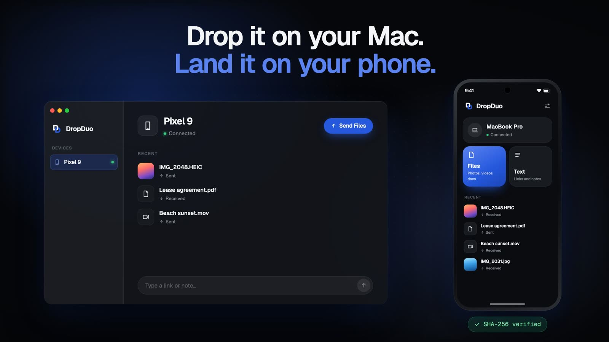

# DropDuo

**Share files, photos, text, and links between your Mac and Android phone.**

Pair once, then send over your local network. Free and open source, with no account, cloud uploads, ads, or analytics.

[Download](https://rohit-yadavv.github.io/dropduo/#download) · [Contribute](CONTRIBUTING.md) · [Changelog](CHANGELOG.md)

## Get started

1. Install on both devices: **macOS 14+** (Apple Silicon or Intel) and **Android 10+**.
2. Connect to the same local network. Scan the Mac's pairing code on Android and approve on the Mac.
3. Drop files into the Mac app or use **Send Files…** from its menu bar icon, or use **Share → DropDuo** on Android. You can also send text and links.

If macOS blocks the first launch, open **System Settings → Privacy & Security** and click **Open Anyway** ([more help](https://rohit-yadavv.github.io/dropduo/mac-install.html)). Keep the Mac awake to receive. On Android, use **Save a copy** to keep received files after uninstalling.

Transfers are encrypted between paired devices and files are integrity-checked. The protocol hasn't had an independent security audit. Please report security issues privately through GitHub rather than in a public issue.

Licensed under [Apache-2.0](LICENSE).
